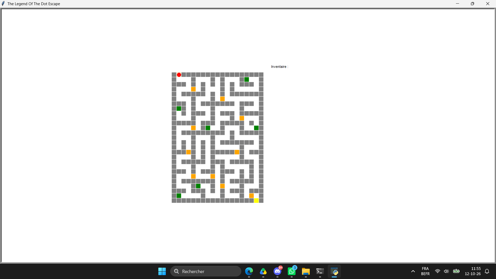

# Python Castle Escape Game 🏰

An interactive, keyboard-controlled escape game developed in **2022** by **Emilion Berger and Johan Marrakchi** as a collaborative programming project for the FUN-MOOC course *Apprendre à coder avec Python*.

The game implements **Level 4**, the complete escape-game level described in the course assignment.

## Gameplay



The player explores a castle represented as a grid, collects objects, answers questions to unlock doors, and tries to reach the exit.

## Features

- Interactive castle map drawn using Python's built-in `turtle` graphics
- Arrow-key movement and collision detection
- Collectible objects and an on-screen inventory
- Locked doors with question-and-answer challenges
- Victory condition when the player reaches the exit
- Game content loaded from external text files

## Running the game

**Requirements:** Python 3, a graphical desktop environment, and Tkinter/Turtle support. No external Python packages are required.

Download the repository files into the same folder and open a terminal there.

**Windows:**

```powershell
py BERGER_MARRAKCHI.py
```

**macOS / Linux:**

```bash
python3 BERGER_MARRAKCHI.py
```

Click inside the game window if needed, then use the arrow keys. Enter answers when prompted at locked doors.

## Project files

| File | Description | Attribution |
| --- | --- | --- |
| `BERGER_MARRAKCHI.py` | Python game implementation | Emilion Berger and Johan Marrakchi |
| `CONFIGS.py` | Display settings and file paths | Supplied with the course |
| `plan_chateau.txt` | Castle map | Course dataset |
| `dico_objets.txt` | Collectible-object data | Course dataset |
| `dico_portes.txt` | Door questions and answers | Course dataset |
| `screenshots/escape_game_gameplay.png` | Screenshot of the running game | Captured for this portfolio |

The course-provided configuration and datasets are distinguished from the student-developed game implementation.

## Verification

The game was launched in a graphical test environment, and an automated simulated playthrough exercised item collection, door interactions, and the victory condition. It was also launched on Windows by one of the authors. Automated simulation does not replace exhaustive manual testing.

## Credits and context

**Student developers:** Emilion Berger and Johan Marrakchi (2022).


**Course:** *Apprendre à coder avec Python*, FUN-MOOC.

This project was collaboratively developed as part of a Python programming course. The game implementation was written by the two student developers, while the configuration and game datasets were provided as part of the course materials.

**Note:** The source code is co-authored, and the course materials may be subject to separate usage and redistribution rights.
